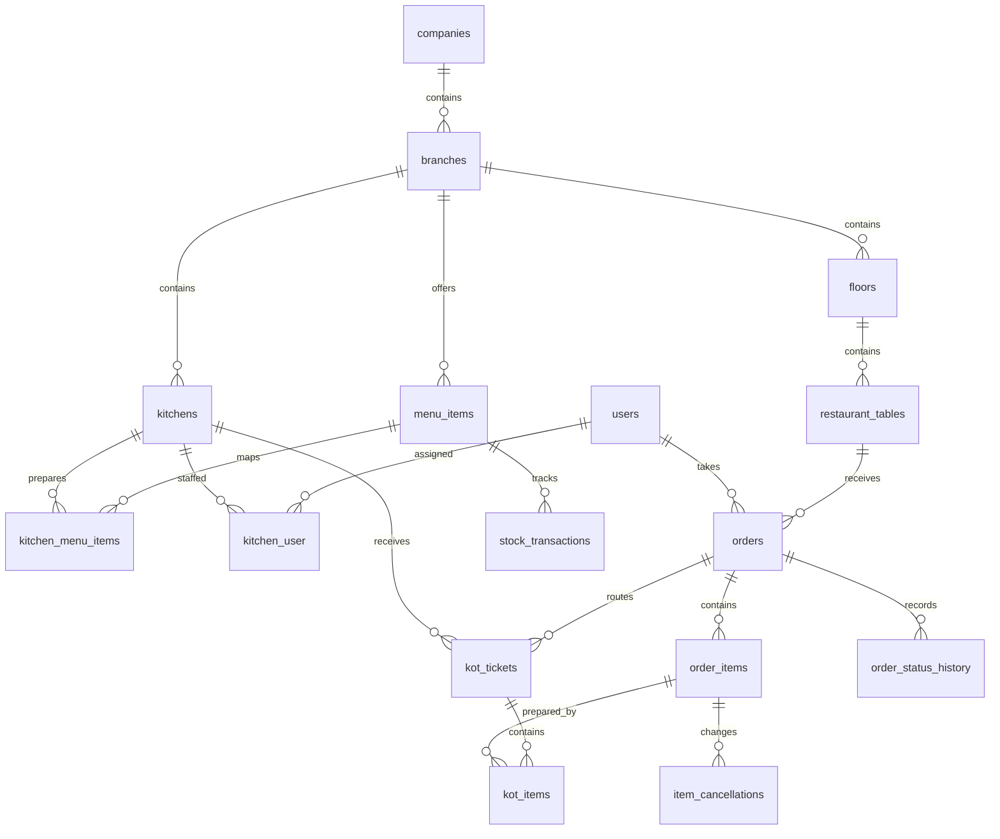

# Nagarjuna database and transaction design

The Laravel migrations are the schema authority. Production uses MySQL. Operational data is separated by company and branch; child rows without those columns inherit scope through their required parent foreign key. Master/order/KOT models use soft deletion where defined, preserving historical references. Foreign keys restrict deletion of masters in use; order-owned children cascade with their parent as specified in migrations.

## Data dictionary

| Table | Main fields and relationships | Rules |
|---|---|---|
| companies | id, name, code, address, phone, email, gst_number, is_active | Company code is unique; active company required for staff access. |
| branches | company_id, name, code, contact/address, is_active, cancellation_approval_required | Belongs to company; approval flag requires a separate decision-maker. |
| kitchens | company_id, branch_id, name, code, kitchen_type, description, is_active, display_token_hash, display_token_created_at | Friendly display URL is derived from branch/kitchen codes; registered TV secret is stored only as a hash and registration rotates access. |
| floors | company_id, branch_id, name, nullable code, description, is_active | Scoped to active branch. |
| restaurant_tables | company_id, branch_id, floor_id, name, seating_capacity, table_status, is_active | Available/Occupied/Reserved/Cleaning; locked during order creation and release. |
| categories | company_id, nullable branch_id, name, code, description, display_order, is_active | Company-wide or branch category. |
| menu_types | company_id, nullable branch_id, name, description, is_active | Dietary/menu classification. |
| menu_items | company_id, branch_id, category_id, menu_type_id, name, code, description, image, selling_price, preparation_instructions, display_order, availability, stock_tracking_enabled, prepared_stock_quantity, is_active | Prepared portions are stored once per branch dish. Null tracked quantity means not configured. Availability is independent of numeric stock. |
| kitchen_menu_items | company_id, branch_id, menu_item_id, kitchen_id, is_active | Unique dish/station mapping; multiple stations supported. All linked masters must have consistent tenant/branch. |
| users | company_id, branch_id, name, employee_code, designation, phone, email, password, is_active | Password is hashed and hidden; active tenant/account checks apply each request. |
| roles, permissions | role name/slug/status; permission module/action/slug | Active roles grant configurable module permissions. |
| user_roles, role_permissions | required foreign IDs, timestamps | Unique relation pairs. |
| kitchen_user | user_id, kitchen_id, timestamps | Explicit station assignments; an empty assignment set grants no kitchen access. |
| personal_access_tokens | token hash, tokenable identity, abilities, last_used_at, expires_at | Separate waiter/kitchen abilities; seven-day mobile expiry. |
| orders | company_id, branch_id, table_id, waiter_id, order_number, guest_count, customer fields, status, total_amount, special_instructions | Globally unique order number. Monetary fields are references, not invoicing or payments. |
| order_items | order_id, menu_item_id, quantity, cancelled_quantity, unit_price, total_price, special_instructions, status | Original quantity retained. Active quantity = original minus approved cancellation. |
| kot_tickets | company_id, branch_id, kitchen_id, order_id, kot_number, numbering_period, ticket_status, accepted_at, preparing_at, ready_at, duration_seconds, notes | New tickets unique on branch + numbering period + number. Legacy rows retain null period without renumbering. |
| kot_items | kot_ticket_id, order_item_id, menu_item_id, quantity, cancelled_quantity, special_instructions, item_status | Each preparation station holds the customer's full line quantity; this duplication of work must not duplicate stock deduction. |
| mobile_api_idempotency_keys | user_id, idempotency_key, operation, request_hash, order_id | Unique account/key. Atomically connects a committed request to its order; payload reuse is checked. |
| item_cancellations | company_id, branch_id, order_id, order_item_id, request_batch, quantity, reason, status, requested_by, decided_by, decided_at, decision_note, stock_reversed, stock_reversed_quantity, wastage_quantity | Pending/approved/rejected records preserve the decision trail and quantity policy. |
| stock_transactions | company_id, branch_id, menu_item_id, user_id, nullable order_id/item_cancellation_id, transaction_type, quantity, quantity_delta, stock_before, stock_after, reason, timestamps | Complete stock ledger; movements are immutable operational history. Cancellation wastage has zero extra deduction because the order already consumed stock. |
| mobile_device_tokens | user_id, personal_access_token_id, client, token_ciphertext, token_hash, platform, last_seen_at | Token revocation cascades registration removal; the model exposes decrypted token only to push delivery, not API responses or logs. |
| document_sequences | unique scope, last_number, timestamps | Locked counter for global order numbers and branch/period KOT numbers. Shared by create and add-items. |
| settings | company_id, branch_id, key, JSON value, timestamps | Unique branch/key; numbering format, reset policy, sound permission and low-stock threshold. |
| audit_logs | company_id, branch_id, user_id, action, subject_type, subject_id, JSON changes, created_at | Critical master/stock/order/cancellation/access/settings changes. Passwords, display secret hashes and remember tokens excluded. |
| order_status_history | company_id, branch_id, order_id, user_id, subject_type, subject_id, from_status, to_status, created_at | Order, line, ticket and kitchen-item transitions, including initial states. |

Standard Laravel jobs/failed_jobs/job_batches, cache/cache_locks, sessions and password-reset infrastructure are defined in the framework migrations. They do not substitute for operational history.

## Core relationships

## Transaction and status rules

1. **Create:** lock table, reject an existing active order, lock dish rows in ID order, validate availability/stock, allocate order number, create order/lines, write one stock deduction per dish, create KOT work for every active assigned station, then commit. A missing mapping rolls back the entire submission.
2. **Add:** lock the existing order/table; repeat dish validation/deduction for only the new batch. Original work is preserved. The same KOT counter is used by create and additions.
3. **Preparation:** lock the order and its tickets in a consistent order before checking current state. Only New → Accepted → Preparing → Ready → Served transitions are allowed. A repeated current state is safe; backwards/skipped/direct-cancellation transitions fail. Fully cancelled lines remain terminal.
4. **Several stations:** the customer line uses the slowest active station state. Each station receives the full quantity, while inventory and pricing remain on the customer line once. A waiter can serve a line only after every station is Ready/Served.
5. **Cancellation:** lock order/tickets/lines and affected menu rows. Cancel the same customer quantity at every linked station. Restore that quantity once only when all stations are New/Accepted; otherwise record it once as wastage. No prepared or served stock is automatically returned. Full cancellation releases the table.
6. **Completion:** all active tickets must be Ready/Served, with no pending cancellation. Completion releases the locked table in the same transaction.
7. **Retries:** idempotency ledger and order changes commit together. Duplicate requests with the same identity replay; changed payloads fail. Transaction deadlocks can retry up to three attempts. After-commit events cannot advertise rolled-back orders.

The model observer writes audit/status history in the enclosing transaction. Role/permission and kitchen-assignment pivot changes are recorded explicitly because pivot synchronization does not emit normal model updates. Bulk operations must preserve this history contract.

## Numbering and settings

Default order numbers are `ORD-0001` with a global counter. Default KOT numbers are `KOT-1` in a branch/day counter. Prefixes and minimum digit counts can be configured; a KOT reset can be daily or continuous. The sequence allocator locks its row until the outer order transaction commits. Database uniqueness is the final backstop. Do not reset counters or delete sequence rows manually.

Legacy numbers and nullable numbering periods remain unchanged. The first allocation seeds its counter above existing trailing numbers. API/relationships always identify tickets by database ID; a human KOT number is interpreted with branch and numbering period.

Set `APP_TIMEZONE` consistently before deployment; it governs server clock formatting, daily KOT periods and scheduler execution. Mobile received times are converted from ISO timestamps to device-local time. Changing the timezone or numbering policy is an operational configuration change and must be planned around active service.

## Migration and retention

The remediation migrations are `2026_11_13_100000_add_operational_sequences_settings_and_audit`, `2026_11_13_100100_add_reporting_and_settings_permissions` and `2026_11_13_100200_add_kitchen_type`. They add tables/indexes, permission assignments and a kitchen classification without deleting operational records. Existing kitchens default to General and can be edited. Back up before applying them. On other environments apply all earlier pending migrations in order as well; do not run `migrate:fresh` or `migrate:refresh` against restaurant data.

Audit/status capture starts when this code is deployed. Earlier transitions cannot be reconstructed reliably and are not invented. Stock/cancellation history already stored remains available. Define retention, encrypted off-host backup, access and restoration procedures with the restaurant operator; see [OPERATIONS.md](OPERATIONS.md).
